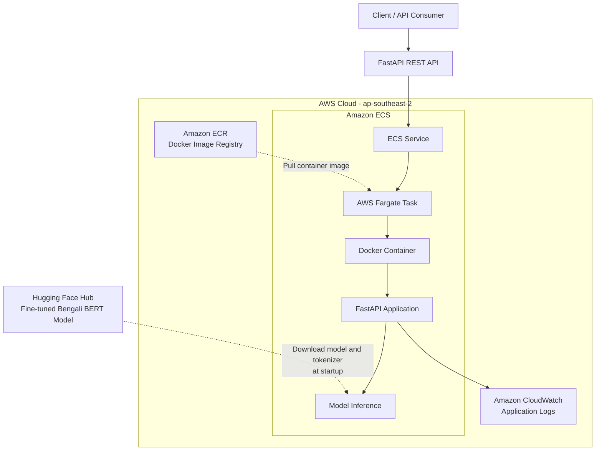
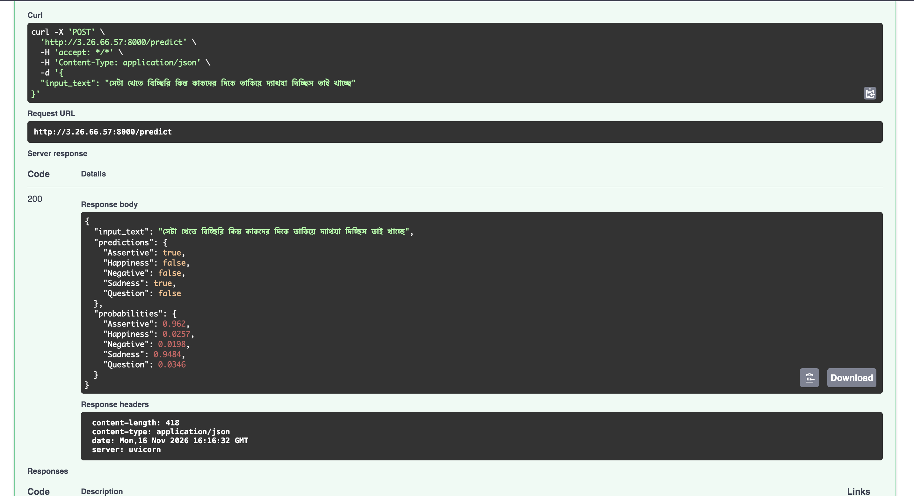
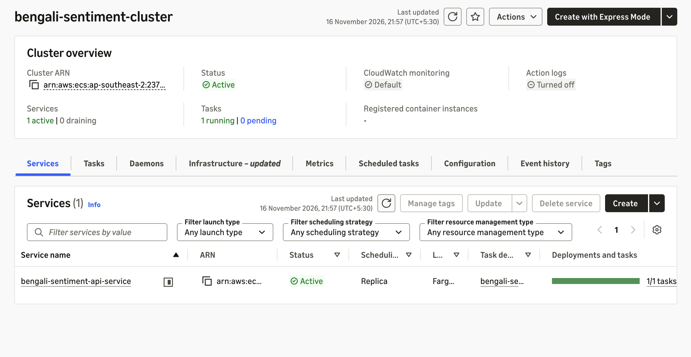
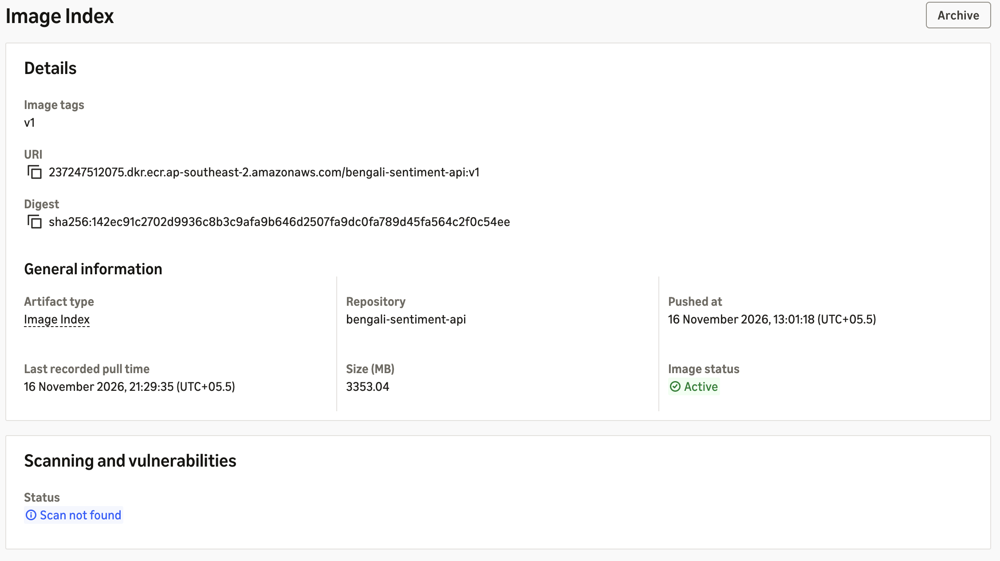
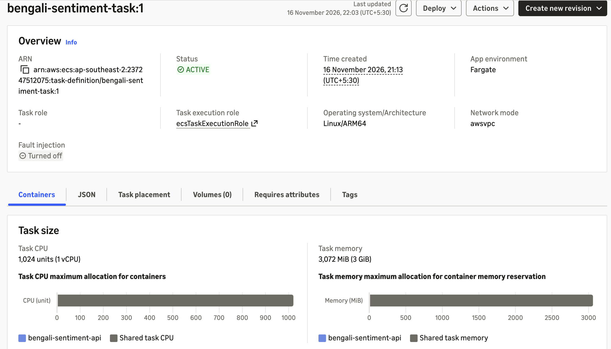
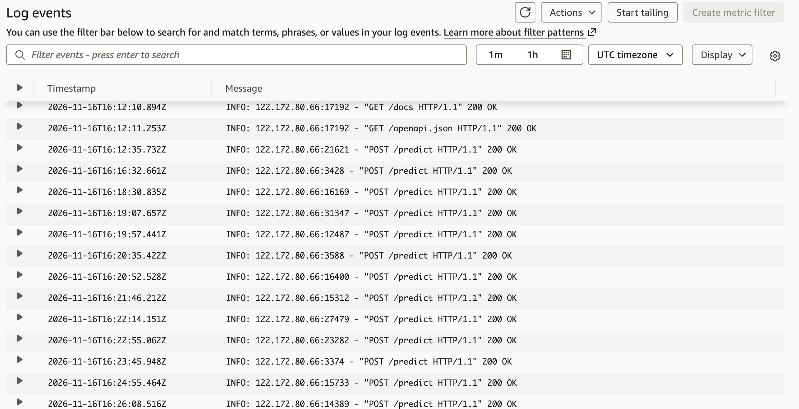
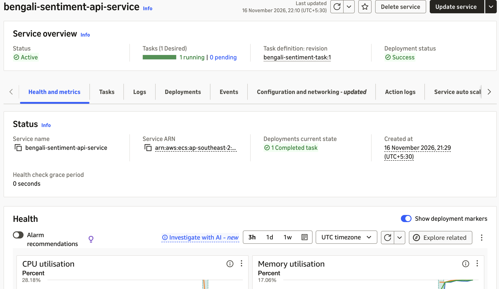

# Bengali Sentiment Analysis API
### Multi-Label Text Classification | FastAPI | Docker | AWS ECS Fargate

A production-oriented REST API for Bengali text sentiment and emotion classification, built using a fine-tuned multilingual BERT model and deployed as a containerized application on AWS.

This project demonstrates an end-to-end machine learning deployment workflow, covering model integration, inference API development, Docker containerization, container image management, cloud deployment, and application monitoring.

---

## Table of Contents

- [Project Overview](#project-overview)
- [Architecture](#architecture)
- [Model Information](#model-information)
- [Technology Stack](#technology-stack)
- [Project Structure](#project-structure)
- [API Documentation](#api-documentation)
- [Local Setup](#local-setup)
- [Docker Deployment](#docker-deployment)
- [AWS Deployment](#aws-deployment)
- [Monitoring and Logging](#monitoring-and-logging)
- [Screenshots](#screenshots)
- [Security Considerations](#security-considerations)
- [Future Improvements](#future-improvements)

---

## Project Overview

The Bengali Sentiment Analysis API accepts Bengali text and predicts multiple sentiment and emotion labels simultaneously.

Unlike traditional single-label classification, this project uses a **multi-label classification approach**, allowing one sentence to be associated with more than one label.

### Classification Labels

| Label | Description |
|---|---|
| Assertive | Positive or favourable expression |
| Happiness | Happiness or joyful emotion |
| Negative | Negative or unfavourable expression |
| Sadness | Sadness or unhappy emotion |
| Question | Interrogative or doubtful expression |

The API returns both binary predictions and their corresponding probability scores.

### Example

**Input:**

```json
{
  "input_text": "আমি আজ খুব আনন্দিত"
}
```

**Output:**

```json
{
  "input_text": "আমি আজ খুব আনন্দিত",
  "predictions": {
    "Assertive": true,
    "Happiness": true,
    "Negative": false,
    "Sadness": false,
    "Question": false
  },
  "probabilities": {
    "Assertive": 0.9527,
    "Happiness": 0.9871,
    "Negative": 0.0212,
    "Sadness": 0.0208,
    "Question": 0.0174
  }
}
```

---

## Architecture

The application follows a containerized inference architecture.

The trained model is hosted on Hugging Face. The FastAPI application downloads the model and tokenizer during container startup, performs inference, and returns predictions through REST endpoints.

### System Architecture



### Architecture Workflow

1. **Model Hosting:** The fine-tuned Bengali sentiment classification model and tokenizer are hosted on Hugging Face.
2. **API Development:** FastAPI exposes REST endpoints for health checks and text predictions.
3. **Containerization:** Docker packages the API application and its Python dependencies into a container image.
4. **Image Registry:** The Docker image is pushed to Amazon Elastic Container Registry (ECR).
5. **Cloud Deployment:** Amazon ECS manages the application deployment, while AWS Fargate provides serverless container compute.
6. **Model Initialization:** When the container starts, the application downloads the model and tokenizer from Hugging Face.
7. **Inference:** The API tokenizes Bengali input, performs model inference, applies sigmoid activation and label-specific threshold comparisons, and returns the results.
8. **Monitoring:** Application startup messages and API request logs are collected in Amazon CloudWatch Logs.

---

## Model Information

| Parameter | Value |
|---|---|
| Model | Bengali Sentiment BERT |
| Hugging Face Repository | [Subha95/bengali-sentiment-bert](https://huggingface.co/Subha95/bengali-sentiment-bert) |
| Base Model | `google-bert/bert-base-multilingual-cased` |
| Architecture | Multilingual BERT |
| Task | Multi-label Text Classification |
| Number of Labels | 5 |
| Maximum Sequence Length | 128 |
| Activation Function | Sigmoid |
| Decision Threshold | 0.5 per label |

The inference pipeline calculates an independent probability for each label. A prediction is marked `true` when its probability meets or exceeds the configured threshold.

The model is loaded once during application startup rather than being reloaded for every API request.

---

## Technology Stack

| Category | Technologies |
|---|---|
| Programming Language | Python |
| Deep Learning | PyTorch |
| NLP | Hugging Face Transformers |
| Model Hosting | Hugging Face Hub |
| API Framework | FastAPI |
| API Server | Uvicorn |
| Containerization | Docker |
| Container Registry | Amazon ECR |
| Container Orchestration | Amazon ECS |
| Cloud Compute | AWS Fargate |
| Logging | Amazon CloudWatch |
| Cloud CLI | AWS CLI |

---

## Project Structure

```text
bengali-sentiment-api/
│
├── app/
│   ├── __init__.py
│   ├── main.py
│   ├── model.py
│   ├── predictor.py
│   └── config.py
│
├── screenshots/
│   ├── 01_live_api_prediction.png
│   ├── 02_ecs_service_deployment.png
│   ├── 03_fargate_task_details.png
│   ├── 04_ecr_docker_image.png
│   ├── 05_ecs_task_definition.png
│   ├── 06_cloudwatch_application_logs.png
│   └── 07_ecs_cluster_overview.png
│
├── deployment_config.json
├── requirements.txt
├── Dockerfile
├── .dockerignore
├── .gitignore
└── README.md
```

### Application Modules

- **main.py:** Defines the FastAPI application, startup lifecycle, health endpoint, and prediction endpoint.
- **model.py:** Loads the Hugging Face tokenizer and classification model and selects the available compute device.
- **predictor.py:** Performs tokenization, inference, sigmoid probability calculation, and multi-label thresholding.
- **config.py:** Loads deployment settings and exposes model configuration, label names, and thresholds.
- **deployment_config.json:** Stores the model identifier, base model, classification settings, label names, and thresholds.

---

## API Documentation

The application exposes the following endpoints:

| Method | Endpoint | Description |
|---|---|---|
| GET | `/` | API information |
| GET | `/health` | Application and model health status |
| POST | `/predict` | Bengali text classification |

### Health Check

**Request:**

```http
GET /health
```

**Example response:**

```json
{
  "status": "healthy",
  "model_loaded": true
}
```

### Text Prediction

**Request:**

```http
POST /predict
Content-Type: application/json
```

**Request body:**

```json
{
  "input_text": "আমি আজ খুব আনন্দিত"
}
```

The response includes the original input, binary label predictions, and probability scores.

### Interactive API Documentation

FastAPI automatically generates interactive API documentation.

Once the application is running, access:

```text
http://localhost:8000/docs
```

---

## Local Setup

### 1. Clone the Repository

```bash
git clone https://github.com/YOUR_USERNAME/bengali-sentiment-api.git

cd bengali-sentiment-api
```

### 2. Create a Virtual Environment

```bash
python -m venv venv
```

Activate it:

**macOS / Linux**

```bash
source venv/bin/activate
```

**Windows**

```bash
venv\Scripts\activate
```

### 3. Install Dependencies

```bash
pip install -r requirements.txt
```

### 4. Run the API

```bash
uvicorn app.main:app --host 0.0.0.0 --port 8000
```

Open the interactive documentation:

```text
http://localhost:8000/docs
```

The application downloads the model and tokenizer from Hugging Face during startup. Internet access is therefore required unless the model files are already available locally.

---

## Docker Deployment

The application is packaged as a Docker image to provide a consistent runtime environment.

### 1. Build the Docker Image

```bash
docker build -t bengali-sentiment-api:v1 .
```

### 2. Run the Container

```bash
docker run -d \
  --name bengali-sentiment-container \
  -p 8000:8000 \
  bengali-sentiment-api:v1
```

### 3. Verify the Container

```bash
docker ps
```

### 4. View Application Logs

```bash
docker logs bengali-sentiment-container
```

### 5. Test the API

```text
http://localhost:8000/docs
```

The container exposes port `8000`, which is mapped to port `8000` on the host machine.

---

## AWS Deployment

The Dockerized application was deployed using Amazon ECS with AWS Fargate.

### AWS Services Used

| AWS Service | Purpose |
|---|---|
| Amazon ECR | Stores the Docker container image |
| Amazon ECS | Manages the container deployment |
| AWS Fargate | Runs the container without managing EC2 instances |
| Amazon CloudWatch Logs | Collects application logs |
| IAM | Provides permissions for ECS task execution |
| VPC | Provides networking for the Fargate task |
| Security Groups | Controls inbound and outbound network traffic |

### Deployment Configuration

| Configuration | Value |
|---|---|
| AWS Region | Asia Pacific (Sydney) - `ap-southeast-2` |
| ECS Cluster | `bengali-sentiment-cluster` |
| ECS Service | `bengali-sentiment-api-service` |
| Task Definition | `bengali-sentiment-task:1` |
| Container Image | Amazon ECR |
| Launch Type | Fargate |
| Operating System | Linux |
| Architecture | ARM64 |
| CPU | 1 vCPU |
| Memory | 3 GiB |
| Container Port | 8000 |
| Log Destination | Amazon CloudWatch Logs |

### Deployment Workflow

1. Build the Docker image locally.
2. Authenticate Docker with Amazon ECR using AWS CLI.
3. Tag the image with the ECR repository URI.
4. Push the image to Amazon ECR.
5. Create an ECS task definition referencing the ECR image.
6. Configure the Fargate runtime, CPU, memory, container port, and CloudWatch logging.
7. Create an ECS service using the task definition.
8. Configure VPC subnets, public IP assignment, and security group rules.
9. Verify the running task and test the API through its deployment endpoint.
10. Inspect application startup and prediction request logs in CloudWatch.

### Important Deployment Note

The application was deployed and tested successfully on AWS. After verification and screenshot capture, the ECS service desired task count was set to zero to stop the running Fargate task and avoid ongoing compute charges.

The ECR image, task definition, ECS service, and cluster were retained for documentation and future redeployment.

---

## Monitoring and Logging

Amazon CloudWatch Logs was configured to collect the container's application output.

The logs provide visibility into:

- Deployment configuration loading.
- Hugging Face model and tokenizer initialization.
- Runtime device selection.
- FastAPI application startup.
- Uvicorn server initialization.
- Incoming API requests.
- Successful prediction responses.
- HTTP status codes.

Example successful request log:

```text
INFO: "POST /predict HTTP/1.1" 200 OK
```

This confirms that the deployed API successfully processed prediction requests.

---

## Screenshots

The following screenshots document the AWS deployment and API testing workflow.

### 1. Live API Prediction



### 2. ECS Service Deployment



### 3. Fargate Task Details


### 4. Amazon ECR Docker Image



### 5. ECS Task Definition



### 6. CloudWatch Application Logs



### 7. ECS Cluster Overview



---

## Security Considerations

- The deployed API's inbound security group rule was restricted to a specific client IPv4 address rather than opened to the entire internet.
- AWS credentials and access keys are not stored in the source repository.
- The Docker image is stored in a private Amazon ECR repository.
- The Hugging Face model is loaded from its hosted repository at application startup.
- The deployed service was scaled to zero after testing to avoid unnecessary compute usage.

**Deployment status:** The AWS deployment was successfully tested, but the Fargate service is currently scaled to zero. The API is therefore not currently available at its former deployment IP.

---

## Future Improvements

- Add automated unit and integration tests.
- Introduce request validation and structured error handling.
- Add authentication and API rate limiting.
- Implement CI/CD using GitHub Actions.
- Optimize Docker image size and startup time.
- Evaluate model inference latency and throughput.
- Add centralized monitoring and operational metrics.
- Explore AWS Lambda and Amazon SageMaker deployment options.
- Introduce HTTPS using an appropriate load-balancing and certificate configuration.

---

## Author

**Subhajit Mondal**

Developed as an end-to-end NLP and cloud deployment project, combining Bengali multi-label text classification, REST API development, Docker containerization, and AWS deployment.

### Model

[Subha95/bengali-sentiment-bert — Hugging Face](https://huggingface.co/Subha95/bengali-sentiment-bert)

---

*This project is intended for educational, research, and portfolio demonstration purposes.*